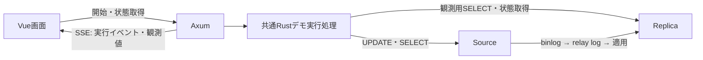

# 可視化フロントエンド 実装計画

## 1. 目的と採用方針

Vue 3の画面から既存のRustデモを実行し、どのサーバーへ何のクエリを発行し、何件のUPDATEが反映されているかを観測できるようにする。Sourceの更新完了後もReplicaが古いmarkerを返す過程と、最終的に追いつく過程を可視化する。

画面では `Master` / `Slave` と表記し、コードとAPIでは既存のSource / Replicaに統一する。本書は実装予定であり、以下のAPIや起動方法はまだ提供されていない。

| 領域 | 採用技術・役割 |
| --- | --- |
| フロントエンド | Vue 3、TypeScript、Vite |
| UI部品 | Reka UIのPopover等。キーボード・タッチ操作にも対応 |
| バックエンド | Rust、Axum、既存のTokio / SQLx |
| 通信 | 操作・スナップショットはHTTP JSON、継続通知はSSE |
| DB起動・構成 | 既存のDocker ComposeとShellを利用 |

最初は1画面とし、ルーターやPiniaは必要になるまで導入しない。PHP版とRust CLI版の既存の実行方法は維持する。初期の画面から起動するエンジンはRust版とする。

## 2. 全体構成

DBの起動とレプリケーション設定は従来どおり事前に行う。バックエンドは接続と稼働状態を検査し、未構成なら実行を拒否して既存の起動手順を表示する。

開発時はViteからAxumへ `/api` をプロキシする。配布時はビルドした画面をAxumから同一オリジンで配信する。初期版はWSL上のローカル利用を想定し、HTTPはループバックへバインドする。DB接続情報はサーバー側で管理し、レスポンスに認証情報を含めない。

## 3. 画面構成

操作可能なHTMLワイヤーフレームは [wireframes/index.html](wireframes/index.html) を参照。5つの場面の切り替え、サンプル再生、バッチ選択、SQL詳細、ホバー説明を確認できる。サンプル値を使う単体HTMLであり、Vue / Axumや実DBとの接続は未実装。

ブラウザでファイルを開くか、プロジェクトルートから `python3 -m http.server 4173 --directory docs/wireframes` を実行し、`http://localhost:4173` を開く。

### 実行設定と全体状態

- 主画面はDB比較、処理一覧、選択したSQLに絞る。装飾的なサイドバー、キャッチコピー、常設の仕組み説明は置かない。
- 対象行数・バッチサイズ・marker投入位置は「処理の流れ」にまとめ、上部に重複した設定サマリーを置かない。
- 行数、seedバッチサイズ、UPDATEバッチサイズ、marker投入位置を設定する。
- 検証済み設定と予定バッチ数を表示し、開始操作で `lag_demo` を再作成することを明示する。
- 状態を「待機・準備・初期同期待ち・実行中・最終同期待ち・完了・失敗」で表示する。
- 実行中の二重開始を禁止し、API側でも拒否する。

### DB比較とstale read

- 両DBの更新反映済み件数 / 対象件数を数値と進捗バーで比較する。
- 両DBのmarker実値、観測時刻、取得中・取得失敗・前回値を表示する。
- Sourceが期待値でReplicaが旧値なら「stale readを観測」と表示し、観測履歴を残す。
- marker一致後も全行の更新確認が終わるまで、デモ全体を完了扱いにしない。
- 自動監視とは別に、任意のタイミングでSlaveへ `SELECT SUM(value) FROM lag_demo.marker` を実行できるボタンを置く。現行markerは1行なのでSUMはその値と等しい。結果と実行時刻を直近5件残し、自動監視や場面の更新で書き換えない。新規実行・リセット時に履歴を消す。
- 手動SELECTはデモ処理を停止せず、独立した短い読み取りとして実行する。取得中・失敗・データ未作成・SUMのNULLを区別し、過去の結果や0で代用しない。SQLは定義済みのものとし、初期版は自由入力を設けない。
- `Stale read：Master = 1 / Slave = 0` の常設メッセージは表示しない。両DBのmarkerと手動SELECT結果で確認できるようにする。
- 最初からmarkerが一致した場合は「stale read未観測」とする。アニメーションで架空の遅延を作らない。
- 主画面には説明用のレプリケーション経路図を置かず、状態と値の比較を優先する。仕組みの説明は既存ドキュメントや処理の詳細で補う。

### 処理の流れとクエリ詳細

seed、重いUPDATEの各バッチ、marker更新、監視、最終同期を一覧化する。予定・実行中・Sourceコミット済み・失敗を示し、Replicaで観測した反映状況は別の項目として示す。

各項目の詳細には以下を含める。

| 項目 | 内容 |
| --- | --- |
| 種類・目的 | 初期投入、大量更新、目印更新、状態観測など |
| 発行先 | Source / Replica / 両方への個別SELECT |
| 対象 | テーブル、バッチ番号、ID範囲、予定件数 |
| SQL | 実装と対応するテンプレート、実際のバインド値、コピー操作 |
| 実績 | 開始・完了時刻、所要時間、更新件数、エラー |
| 反映状況 | Sourceのコミット結果とReplicaの観測結果を区別 |

説明は遅延付きホバーとキーボードフォーカスで表示し、クリック・タッチでも開けるようにする。SQLを選択・コピーできる詳細パネルを用意し、Escapeで閉じて元の操作要素へフォーカスを戻す。

HTMLの属性名は `interestfor` であり、`interesting` ではない。ブラウザ対応を実装時に確認する。初期版はReka UI等で同じ操作を提供し、ネイティブ属性だけに依存しない。色だけで状態を伝えず、テキストとアイコンを併用する。

## 4. 観測値の意味と取得方法

| データ | 取得・算出方法 |
| --- | --- |
| 実行予定 | Configと既存のbatch_rangeから生成 |
| Sourceのバッチ実績 | SQL実行開始・成功・失敗のイベント、rows_affected |
| 更新反映済み件数 | 両DBへ `SELECT COUNT(*) FROM lag_demo.items WHERE version = 2` |
| marker | 両DBへ `SELECT value FROM lag_demo.marker WHERE id = 1` |
| レプリケーション状態 | Replicaへ `SHOW REPLICA STATUS` |
| 最終同期 | 対象件数、全行のversion、marker一致、receiver / applierの稼働を確認 |

COUNTはその観測時点でコミット済みとして見える行数であり、実行中トランザクション内の更新進捗ではない。バッチ単位で値が跳ねる場合がある。件数は初期値version=1から各行を1回更新する現行シナリオを前提とし、再実行時はDBを再作成する。

marker・状態取得は既存のPOLL_INTERVAL_MS（既定500ms）を基本とする。COUNTは初期案として2秒間隔にし、実測に基づいて調整する。観測専用接続を用い、長いトランザクションを維持せず、タイムアウトと同一取得処理の重複禁止を設ける。ブラウザごとにDB監視を増やさず、サーバー側の1つの監視結果を配信する。

両DBの値は厳密な同時刻のスナップショットではない。それぞれに取得時刻と取得所要時間を付ける。取得失敗を0件として扱わず、前回値と鮮度を表示する。

`Seconds_Behind_Source` のNULLは不明として表示する。relay logのサイズは未反映データ量そのものではない。read / exec位置はファイル名も併記し、位置の差を未反映行数へ変換しない。Replicaのバッチ別反映状況が必要な場合はID範囲とversionによる低頻度の照会を追加し、全体COUNTから推測しない。

## 5. APIとイベントの初期案

| API | 用途 |
| --- | --- |
| `GET /api/state` | 最新の実行状態、設定、DB観測値、イベントの最終番号 |
| `POST /api/runs` | 検証済みパラメータで新しい実行を開始。run_idを返す |
| `POST /api/runs/{id}/reads` | Slaveで定義済みmarker SUMをその場で取得し、結果・実行時刻・所要時間を返す |
| `GET /api/runs/{id}` | 実行計画、最新状態、直近の履歴を取得 |
| `GET /api/runs/{id}/events` | SSEで実行イベントと観測値を配信 |

イベントは `run_id`、単調増加する `sequence`、UTC時刻、種類、payloadを持つ。SQL関連は `operation_id`、発行先、テンプレート、バインド値を持ち、開始と結果を対応付ける。フロントエンドは未受信の結果を成功扱いにしない。

主なイベントは `run_phase_changed`、`query_started`、`query_completed`、`query_failed`、`db_observed`、`stale_read_observed`、`run_completed`、`run_failed` とする。高頻度の監視クエリは種別ごとに集約表示し、履歴量に上限を設ける。

最新スナップショットと上限付きのイベント履歴をサーバーで保持する。SSEのLast-Event-IDで再接続し、履歴が欠ける場合はスナップショットを再取得する。ページ再読込で実行を再開しない。SSE切断はデモ中止と区別し、実行を継続する。サーバー再起動による履歴消失・実行中断も明示する。

不正設定は400、同時実行は409で拒否する。クライアントから任意SQLや任意のDB接続先を受け付けず、既定のデモ操作のみ実行する。実行中止と過去実行の永続保存は初期版の対象外とする。

## 6. Rust側の変更方針

- mainのオーケストレーションを共通runnerへ抽出し、CLIとHTTPから呼び出す。
- printlnの文字列を解析せず、構造化したイベントと観測値を生成する。
- workloadのSQL実行箇所に開始・コミット成功・失敗の通知を追加する。
- marker同期後も独立した観測処理を継続し、最終同期まで画面を更新する。
- SQL本文・パラメータは実行処理と詳細表示で共有し、別々のSQL定義によるずれを防ぐ。
- 失敗時は進行中のワーカーの終了を管理し、処理が残ったまま次の実行を受け付けない。
- 同時実行をサーバー内で排他する。CLI・PHPとの同時実行は排他の対象外となるため、利用手順で禁止する。

想定構成は `frontend/` にVueアプリ、`src/lib.rs` と `src/runner.rs` に共有処理、`src/events.rs` に通知型、`src/api.rs` と `src/bin/server.rs` にHTTPサーバーを置く。既存CLIの `cargo run --release` が曖昧にならないよう、複数バイナリ化時はCargoのdefault-runを設定する。

## 7. 実装手順

1. 共通runnerとイベント型を抽出し、既存CLIの動作を維持する。
2. Axumに開始・状態取得API、排他制御、SSEを追加する。
3. Vueに全体状態、両DB比較、markerとstale read表示を実装する。
4. 実行計画とバッチ一覧、SQL詳細、ホバー・フォーカス・クリック操作を追加する。
5. 件数監視、切断復帰、エラー・鮮度表示、最終同期判定を接続する。
6. 実DBで負荷と観測の影響を確認し、起動手順と検証記録をdocsへ追加する。

## 8. 検証と完了条件

- 既存Rust / PHP単体テスト、静的チェック、E2Eを維持する。
- APIの設定不正、二重開始、失敗後のワーカー終了、SSE再接続を検証する。
- フロントエンドの型チェックとビルドを実施し、観測失敗・古い値・stale read未観測を確認する。
- Docker上の実DBで、画面のSQL実績と両DBの実値が一致することを検証する。
- 大量更新の継続中にmarkerの不一致を観測し、その後markerと全行が同期するまで表示を更新する。
- stale readが発生しない実行も正しく表示し、通信断とDB障害を区別する。
- 監視あり・なしの所要時間を記録し、観測負荷の影響を説明する。
- キーボード、タッチ、ポップオーバー内のコピー操作、主要ブラウザとWSLからの閲覧を確認する。
- READMEから画面の起動・利用・データ再作成の説明へ到達できるようにする。
