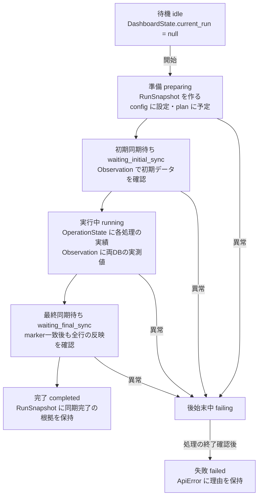
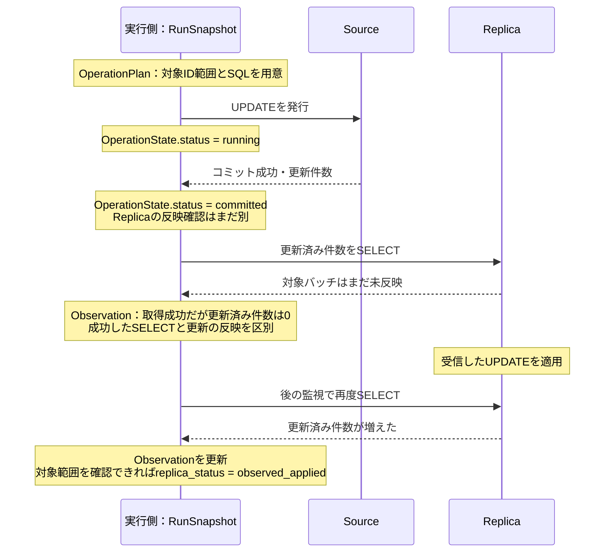

# 今読む型はどれか

まずTypeScriptの `frontend/src/types/api.ts` で `RunSnapshot` を探してください。
Rustの定義は同じ通信形式を表すので、最初から両方を読む必要はありません。

## 中心になる4つの概念

| 概念 | 型 | このデモでの意味 |
| --- | --- | --- |
| 実行全体 | RunSnapshot | 今どの段階か。設定と、以下の予定・結果をまとめる |
| 処理の予定と実績 | OperationPlan / OperationState | 5万行UPDATEの範囲とSQL／Sourceでコミットできたか |
| DBの実測値 | Observation | SourceとReplicaでmarkerや更新済み件数がいくつだったか |
| 手動SELECT結果 | ManualRead | ボタンを押した時点でReplicaから何が読めたか |

RunSnapshotの `plan` と `operations` は同じ `operation_id` で対応します。
予定のSQLと、実行して得た結果を分けているためです。
`observations` は自動監視、`manual_reads` はボタンを押して残した履歴です。

## 実行のライフサイクルと型

次の図は、型が表す予定の実行ライフサイクルです。状態遷移とデータの検証は実装済みですが、この順序を実際に動かす共通runner・HTTP・画面は後続ステップで実装します。

矢印は `RunPhase` の変化です。`RunSnapshot` 自体が別の型に変わるわけではなく、同じ実行の `phase` と中身を更新します。実行前の待機は `current_run = null` で表します。`RunPhase.idle` は遷移の入口ですが、待機を表すためだけの架空の実行は作りません。

| 時点 | まず見る型・フィールド | 読み取れること |
| --- | --- | --- |
| 開始前 | DashboardState.connections | DBに接続できるか。実行結果とは別 |
| 開始時 | RunSnapshot.config / plan | 今回の負荷設定と、実行する予定のSQL |
| SQL実行後 | OperationState.status | Sourceで処理が完了したか。Replicaの反映はまだ別 |
| 自動監視時 | Observation | その取得時点で各DBから何が読めたか |
| 手動SELECT時 | ManualRead | ボタンを押した時点の結果。自動監視の値で上書きしない |
| 終了時 | RunSnapshot.phase / observations | 全更新・marker・レプリケーションの稼働を確認できたか |

## 1バッチを型で追う

次の図は、SourceへのUPDATE成功後もReplicaが未反映である場合の例です。SourceのコミットとReplicaの観測は別の事実なので、それぞれ別の型に残します。

`OperationState.status` は処理の実績、`replica_status` はその処理がReplicaでも反映されたかの確認状況です。全体のCOUNTが増えただけでは、特定バッチを反映済みとは断定せず、対象範囲の照会などの根拠を必要とします。

`ManualRead` はこの流れの途中で独立して取得する結果です。取得中・成功・失敗を持ちますが、手動SELECTを押したこと自体で `RunPhase` は変わりません。`EventEnvelope` は、こうした状態や結果を画面へ知らせる通知の形式です。

markerの不一致は `RunPhase` の一段階ではなく、監視中に観測する事実です。一度観測したことを `stale_read_observed` に残し、markerが追いついてもその記録は保持します。markerの一致だけでは `completed` に進めません。

## 必要になってから読む型

| 型 | 読むタイミング |
| --- | --- |
| RunConfig | 行数やバッチサイズを確認するとき |
| DashboardState / DatabaseConnection | 実行開始前やDB停止時の表示を確認するとき |
| RunPhase | preparing、running、completed等の段階を確認するとき |
| 各Status / Kind | 中心の型のフィールドで、選択肢を知りたいとき |
| ReplicationState | receiver・applierや遅延指標を確認するとき |
| ApiError / ContractError | 利用者向けエラーと検証エラーを実装するとき |
| EventEnvelope / EventPayload | SSEによる継続通知を実装するとき。eventsファイルに分離済み |

DecimalStringは行数等をJSONの数値精度で失わないための文字列、UtcTimestampはUTC時刻の文字列です。
どちらも別の処理モデルではなく、値の表現に付けた名前です。

## 現時点で残していること

今回は読み口とファイル構成を整理しています。JSON形式と公開importは維持しています。
SSEの型は既存の契約テストが参照するため残し、最初に読むファイルから分離しました。
DTO検証と状態遷移は実装済みです。Rustは `src/contracts/validation.rs`、TypeScriptは `frontend/src/types/validation.ts` に検証の詳細を分離しています。
正常な完了例のテスト、SSEの未知項目の拒否、必須項目の欠落と明示的なnullの区別も追加しました。
